# ShubhAstro — Technical Documentation

**Version:** 1.0  
**Date:** June 10, 2026  
**Classification:** Internal / Engineering  
**Audience:** Developers, QA, DevOps, Architects, Management

---

## Table of Contents

1. [Executive Summary](#1-executive-summary)
2. [System Architecture](#2-system-architecture)
3. [Infrastructure Architecture](#3-infrastructure-architecture)
4. [Application Flow](#4-application-flow)
5. [Backend Architecture](#5-backend-architecture)
6. [Frontend Architecture](#6-frontend-architecture)
7. [API Documentation](#7-api-documentation)
8. [Authentication & Authorization](#8-authentication--authorization)
9. [CI/CD Pipeline](#9-cicd-pipeline)
10. [Deployment Architecture](#10-deployment-architecture)
11. [Security Architecture](#11-security-architecture)
12. [Monitoring & Logging](#12-monitoring--logging)
13. [Performance Optimization](#13-performance-optimization)
14. [Disaster Recovery](#14-disaster-recovery)
15. [Testing Strategy](#15-testing-strategy)
16. [Cost Estimation](#16-cost-estimation)
17. [Roadmap](#17-roadmap)
18. [Risks & Recommendations](#18-risks--recommendations)
19. [Appendix](#19-appendix)

---

## 1. Executive Summary

### Project Overview

**ShubhAstro** is an AI-powered astrology consultation platform connecting users with professional astrologers for real-time chat, voice, and video consultations. The platform also provides automated AI astrology services including Kundli generation, horoscope predictions, tarot readings, palmistry analysis, and more.

### Business Goals

- Connect users with certified astrologers via chat, voice, and video
- Provide AI-powered astrology tools (Pandit AI, palmistry, face reading, aura photography)
- Monetize through per-minute consultation billing and e-commerce (ShubhMall)
- Achieve 100K+ active monthly users within 12 months of launch

### KPIs

| KPI | Target | Current |
|-----|--------|---------|
| Monthly Active Users | 100K | In Growth |
| Avg Session Duration | 8 min | TBD |
| Consultation Conversion Rate | 15% | TBD |
| LCP (Lighthouse) | < 2.5s | Optimizing |
| Uptime | 99.9% | Target |

### Business Flow Diagram

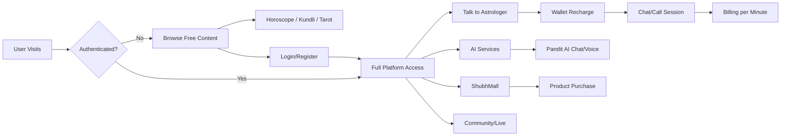

---

## 2. System Architecture

### High-Level Architecture

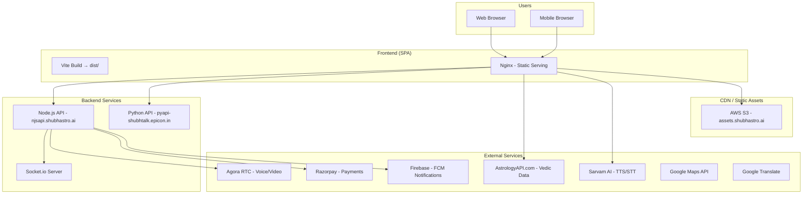

### Request Lifecycle

1. User request hits **Nginx** (serves static SPA or proxies to backend)
2. API requests are proxied via path prefix (`/main/` → Node.js, `/vedic/` → AstrologyAPI, `/chart/` → Python, `/voice/` → Sarvam)
3. WebSocket connections go through `/main/socket.io` for real-time chat/call management
4. Agora SDK handles peer-to-peer voice/video directly (client-side)

### Recommendations

- Add a CDN (CloudFront) in front of Nginx for static assets and SPA files
- Implement API Gateway for rate limiting and request routing
- Add Redis cache layer between backend and external APIs

### Risks

- Single Nginx instance = single point of failure
- No load balancer documented for horizontal scaling
- External API rate limits could cause cascading failures

---

## 3. Infrastructure Architecture

### Infrastructure Diagram

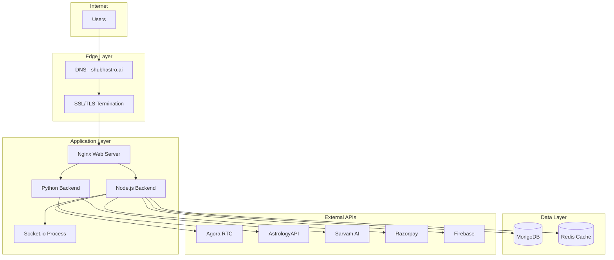

### Server Sizing (Recommended)

| Component | Instance | CPU | RAM | Storage |
|-----------|----------|-----|-----|---------|
| Nginx + Frontend | t3.medium | 2 vCPU | 4 GB | 20 GB |
| Node.js Backend | t3.large | 2 vCPU | 8 GB | 50 GB |
| Python Backend | t3.medium | 2 vCPU | 4 GB | 20 GB |
| MongoDB | m5.large | 2 vCPU | 8 GB | 100 GB |
| Redis | cache.t3.medium | 2 vCPU | 3 GB | — |

### Best Practices

- Use Auto Scaling Groups for Node.js backend
- Deploy MongoDB as a replica set (minimum 3 nodes)
- Use ElastiCache for Redis with Multi-AZ
- Enable automated backups for all data stores

---

## 4. Application Flow

### User Journey - Astrologer Consultation

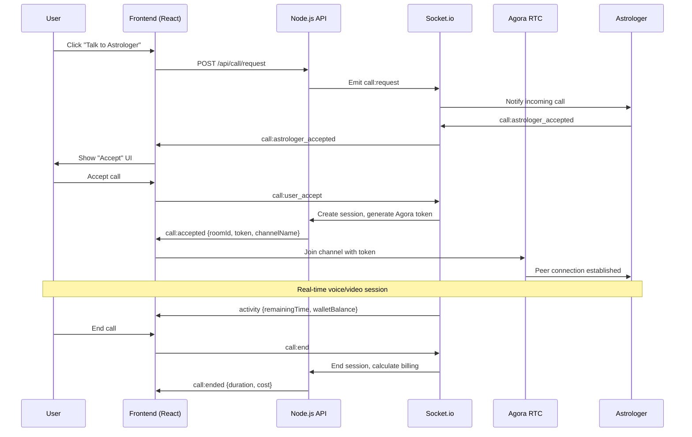

### User Journey - AI Chat (Pandit AI)

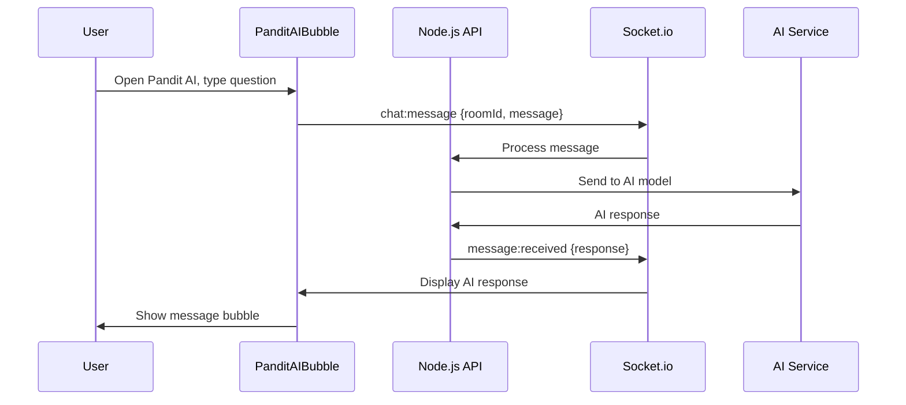

---

## 5. Backend Architecture

### Component Diagram

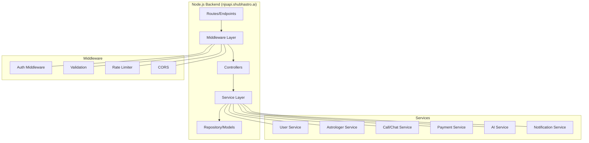

### API Base URLs (Proxied via Nginx)

| Prefix | Target | Purpose |
|--------|--------|---------|
| `/main/` | `njsapi.shubhastro.ai` | Primary backend + WebSocket |
| `/vedic/` | `json.astrologyapi.com` | Vedic astrology calculations |
| `/chart/` | `pyapi-shubhtalk.epicon.in` | Chart generation (Python) |
| `/voice/` | `api.sarvam.ai` | Text-to-Speech / Speech-to-Text |

### Error Handling Strategy

- 401: Auto-redirect to login (debounced, skipped for public endpoints)
- 400-422: User-facing toast with sanitized error message
- 500: Generic "Something went wrong" (hides internal details)
- Network errors: Retry with exponential backoff
- Chunk load errors: Auto-reload page (once)

---

## 6. Frontend Architecture

### Component Diagram

```mermaid
flowchart TB
    subgraph App["App.jsx"]
        HELMET[HelmetProvider - SEO]
        ERR[ErrorBoundary]
        CALL[CallProvider]
        CHAT[ChatProvider]
        QUEUE[WaitingQueueProvider]
        ROUTER[RouterProvider]
    end

    subgraph Pages["Screens (~130+ routes)"]
        HOME[Home / HomeV2]
        HOROSCOPE[Horoscope]
        KUNDLI[Kundli]
        TAROT[Tarot (15+ types)]
        CALC[Calculators (18)]
        AIWOW[AI WOW (6 features)]
        TALK[Talk to Astrologer]
        LIVE[Live Streaming]
        SHOP[ShubhMall]
        PROFILE[Profile]
    end

    subgraph State["State Management"]
        STORE[Redux Store]
        PERSIST[Redux Persist]
        RTK[RTK Query (10 APIs)]
        SLICES[6 Slices]
    end

    subgraph Shared["Shared Components"]
        HEADER[TopHeader]
        FOOTER[Footer]
        PANDIT[PanditAI Bubble]
        MODALS[Modal System]
        CARDS[Card Components]
    end

    HELMET --> ERR --> CALL --> CHAT --> QUEUE --> ROUTER
    ROUTER --> Pages
    Pages --> State
    Pages --> Shared
```

### State Management Architecture

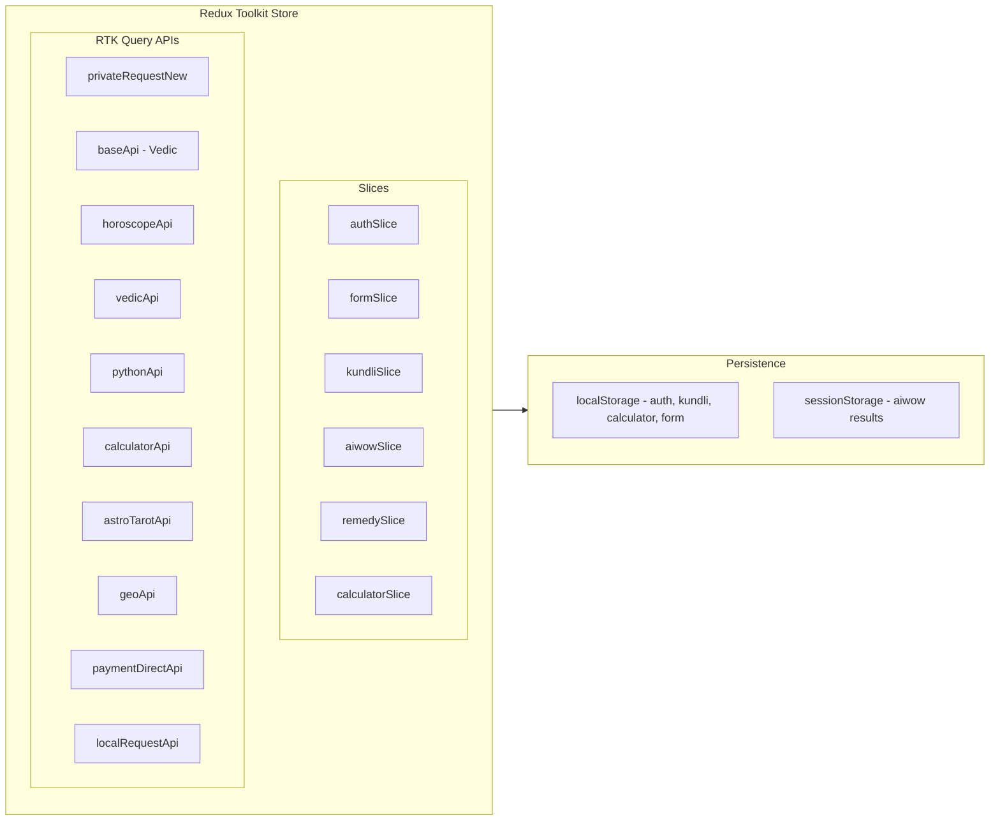

### Routing Architecture

| Route Type | Count | Auth Required | Example |
|------------|-------|---------------|---------|
| Public | 5 | No (redirects if logged in) | `/login`, `/register` |
| Open | 1 | No | `/coming-soon` |
| Private (Protected) | 4 | Yes | `/profile`, `/community` |
| Private (Mixed) | ~125 | No (accessible to all) | `/horoscope`, `/kundli`, `/tarot` |

### Key Libraries

| Library | Version | Purpose |
|---------|---------|---------|
| React | 19.1.1 | UI framework |
| Vite | 7.1.7 | Build tool |
| Redux Toolkit | 2.10.0 | State management |
| React Router DOM | 7.9.1 | Routing |
| Socket.io Client | 4.8.1 | Real-time communication |
| Agora RTC SDK | 4.24.1 | Voice/Video calls |
| Axios | 1.12.2 | HTTP client |
| Firebase | 12.6.0 | Push notifications |
| Formik + Yup | 2.4.6 / 1.7.1 | Form handling |
| Framer Motion | 12.23.19 | Animations |
| Day.js | 1.11.19 | Date handling |

---

## 7. API Documentation

### Internal API (privateRequestNew)

| Method | Endpoint | Purpose |
|--------|----------|---------|
| POST | `/api/users/loginUser` | Phone-based login |
| POST | `/api/users/verifyOtp` | OTP verification |
| POST | `/api/users/registerUser` | User registration |
| GET | `/api/users/live-users` | Astrologer live list |
| POST | `/api/users/live/token/viewer` | Agora viewer token |
| PUT | `/api/users/profile` | Update user profile |
| DELETE | `/api/users/delete-account` | Account deletion |

### External APIs

| API | Base URL | Auth | Purpose |
|-----|----------|------|---------|
| AstrologyAPI | `json.astrologyapi.com` | Basic Auth | Vedic calculations, horoscope |
| Python Service | `pyapi-shubhtalk.epicon.in` | None | Chart generation |
| Sarvam AI | `api.sarvam.ai` | API Key | Text-to-Speech, transliteration |
| Razorpay | Razorpay SDK | Key ID | Payment processing |
| Google Maps | Maps JS API | API Key | Location search |

### API Interaction Diagram

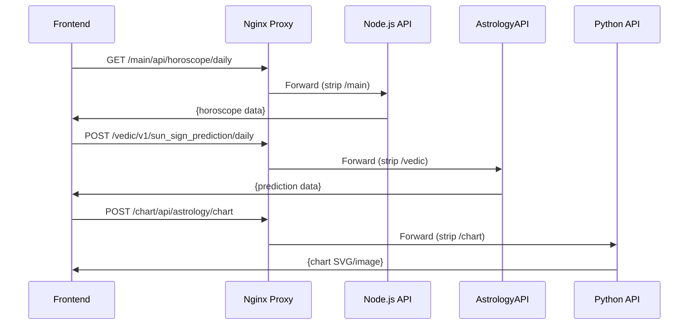

---

## 8. Authentication & Authorization

### Authentication Flow

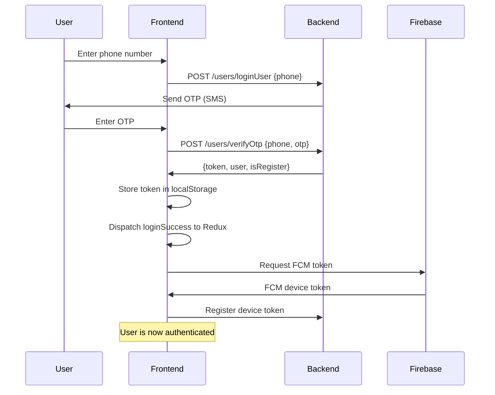

### Token Management

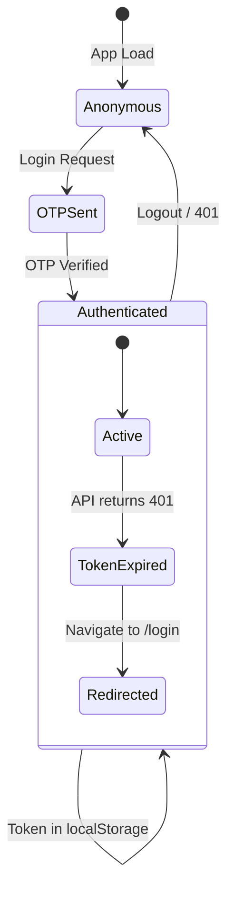

### Role-Based Access

| Role | Storage Key | Token Key | Access |
|------|-------------|-----------|--------|
| CUSTOMER | `shubhtalk_role` | `shubhtalk_customer_token` | Full platform |
| ASTROLOGER | `shubhtalk_role` | `shubhtalk_astro_token` | Dashboard + calls |

### Risks

- Tokens in localStorage are vulnerable to XSS
- No token refresh mechanism (immediate redirect to login on 401)
- Same Firebase/API keys across all environments

### Recommendations

- Implement refresh token rotation
- Move to httpOnly cookies for token storage
- Add CSRF protection
- Separate API keys per environment

---

## 9. CI/CD Pipeline

### Pipeline Diagram

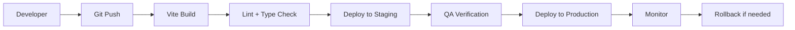

### Build Commands

| Environment | Build | Serve |
|-------------|-------|-------|
| Development | `npm run build-dev` | `npm run start-dev` |
| Staging | `npm run build-stage` | `npm run start-stage` |
| Production | `npm run build-prod` | `npm run preview` |

### Build Process

1. `env-cmd -e {env}` loads environment variables from `.env-cmdrc`
2. `vite build` compiles React + SCSS → optimized JS/CSS bundles
3. `node scripts/generate-sitemap.js` generates sitemap.xml
4. Output: `dist/` folder with hashed assets

### Recommendations

- Add automated testing stage (unit + integration)
- Implement preview deployments for PRs
- Add bundle size budget checks
- Implement blue-green deployment strategy

---

## 10. Deployment Architecture

### Deployment Diagram

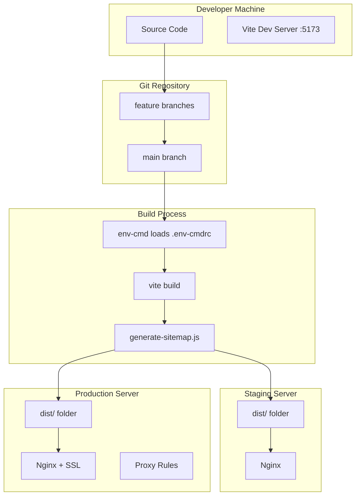

### Nginx Production Configuration

```nginx
# Static SPA serving + API proxying
server {
    listen 443 ssl;
    server_name shubhastro.ai;
    root /path/to/dist;

    # API proxies
    location /main/ { proxy_pass https://njsapi.shubhastro.ai/; }
    location /vedic/ { proxy_pass https://json.astrologyapi.com/; }
    location /chart/ { proxy_pass https://pyapi-shubhtalk.epicon.in/; }
    location /voice/ { proxy_pass https://api.sarvam.ai/; }

    # SPA fallback
    location / { try_files $uri $uri/ /index.html; }
}
```

### Recommendations

- Containerize with Docker for consistent deployments
- Use AWS ECS or Kubernetes for orchestration
- Implement CDN (CloudFront) for static assets
- Add health check endpoints

---

## 11. Security Architecture

### Security Layers

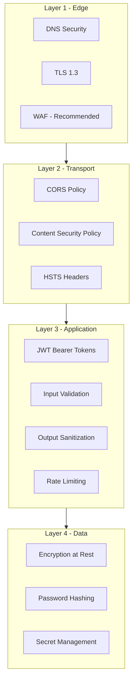

### Current Security Posture

| Control | Status | Priority |
|---------|--------|----------|
| HTTPS/TLS | ✅ Implemented | — |
| JWT Auth | ✅ Implemented | — |
| CORS | ✅ Configured | — |
| Rate Limiting | ⚠️ Backend only | High |
| WAF | ❌ Not implemented | High |
| CSP Headers | ❌ Not implemented | Medium |
| API Key Rotation | ❌ Keys shared across envs | Critical |
| XSS Protection | ⚠️ React auto-escaping | Medium |
| Secret Management | ❌ Committed to git | Critical |

### Critical Risks

1. **API keys in source control** — `.env-cmdrc` contains live Razorpay, Firebase, and third-party API keys
2. **Tokens in localStorage** — Vulnerable to XSS attacks
3. **No WAF** — No DDoS or bot protection
4. **Shared keys across environments** — No isolation between dev/stage/prod

---

## 12. Monitoring & Logging

### Monitoring Flow (Recommended)

```mermaid
flowchart LR
    subgraph App["Application"]
        FE[Frontend Errors]
        API[API Logs]
        SOCK[Socket Events]
    end

    subgraph Collection["Collection"]
        GTM[Google Tag Manager]
        CONSOLE[Console Logs]
        ERRORS[Error Boundaries]
    end

    subgraph Monitoring["Monitoring Stack (Recommended)"]
        SENTRY[Sentry - Error Tracking]
        CW[CloudWatch - Metrics]
        GRAFANA[Grafana - Dashboards]
    end

    subgraph Alerts
        SLACK[Slack Notifications]
        EMAIL[Email Alerts]
    end

    App --> Collection --> Monitoring --> Alerts
```

### Current State

- **GTM**: Implemented for analytics (GTM-T5DTGXHW)
- **Error Boundaries**: Implemented (catches React crashes)
- **Chunk Error Recovery**: Auto-reload on dynamic import failures
- **Socket Logging**: Extensive console logging for all socket events

### Recommendations

- Implement Sentry for production error tracking
- Add APM (Application Performance Monitoring)
- Set up structured logging (remove console.logs, use proper logger)
- Implement custom metrics (session duration, API latency, error rates)

---

## 13. Performance Optimization

### Performance Strategy

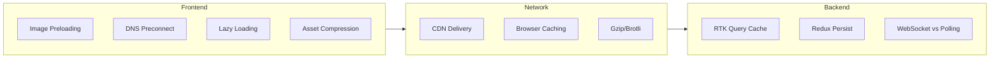

### Current Optimizations

| Optimization | Status | Impact |
|-------------|--------|--------|
| Image preloading (LCP) | ✅ | High |
| DNS preconnect | ✅ | Medium |
| fetchPriority hints | ✅ | High |
| CDN for images | ✅ (assets.shubhastro.ai) | High |
| Lazy-loaded components | ⚠️ Partial | High |
| Route-level code splitting | ❌ Not implemented | Critical |
| Console stripping in prod | ✅ (esbuild) | Low |
| Redux persist | ✅ | Medium |

### Recommendations

- Implement `React.lazy()` for all route components (currently 100+ eagerly loaded)
- Add service worker for offline caching
- Implement image optimization pipeline (WebP/AVIF)
- Add Brotli compression on Nginx
- Bundle analysis and tree-shaking audit

---

## 14. Disaster Recovery

### Recovery Architecture

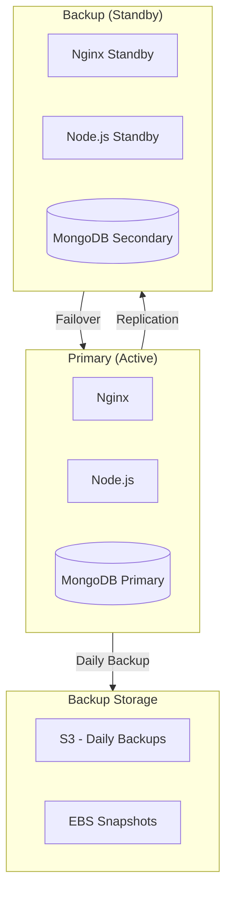

### Recovery Targets

| Metric | Target | Strategy |
|--------|--------|----------|
| RTO (Recovery Time Objective) | 30 minutes | Standby + automated failover |
| RPO (Recovery Point Objective) | 5 minutes | Replica set + transaction logs |
| Backup Frequency | Every 6 hours | Automated snapshots |
| Retention Period | 30 days | S3 lifecycle policy |

### Recommendations

- Implement Multi-AZ deployment
- Automate database failover
- Test disaster recovery quarterly
- Document runbooks for each failure scenario

---

## 15. Testing Strategy

### Testing Pyramid

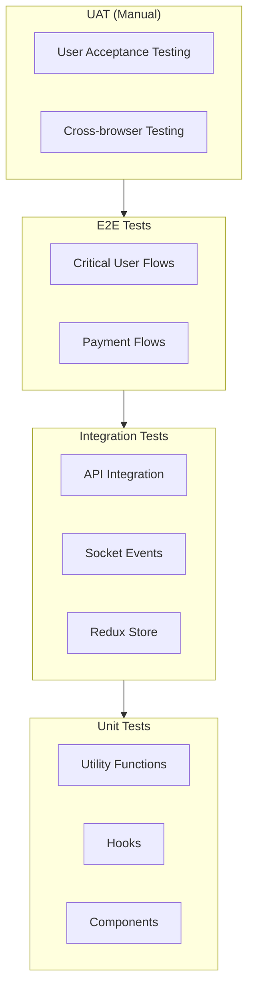

### Current State

| Test Type | Status | Coverage |
|-----------|--------|----------|
| Unit Tests | ❌ Not implemented | 0% |
| Integration Tests | ❌ Not implemented | 0% |
| E2E Tests | ❌ Not implemented | 0% |
| Linting | ✅ ESLint 9 | Configured |
| Type Checking | ❌ (JS, not TS) | 0% |

### Recommendations

- Add Vitest for unit testing (Vite-native)
- Add React Testing Library for component tests
- Add Playwright for E2E critical paths
- Target 60% unit coverage, 100% critical path E2E

---

## 16. Cost Estimation

### Monthly Infrastructure Cost (Estimated)

| Service | Specification | Monthly Cost (USD) |
|---------|--------------|-------------------|
| Nginx Server | t3.medium | $30 |
| Node.js Backend | t3.large | $60 |
| Python Backend | t3.medium | $30 |
| MongoDB (Atlas M10) | 2 vCPU, 8 GB | $85 |
| Redis (ElastiCache) | cache.t3.medium | $50 |
| S3 (Assets) | ~50 GB | $5 |
| CloudFront CDN | ~500 GB transfer | $50 |
| SSL Certificate | ACM (Free) | $0 |
| **Subtotal Infrastructure** | | **~$310** |

### External Service Costs

| Service | Plan | Monthly Cost (USD) |
|---------|------|-------------------|
| Agora RTC | Pay-as-you-go | $100-500 (usage) |
| AstrologyAPI | Enterprise | $50-200 |
| Sarvam AI (TTS) | Pay-per-use | $50-150 |
| Razorpay | Transaction fees | 2% per txn |
| Firebase (FCM) | Free tier | $0 |
| Google Maps | $200 credit/mo | $0-50 |
| **Subtotal Services** | | **~$250-900** |

### Total Estimated: $560 - $1,210/month

---

## 17. Roadmap

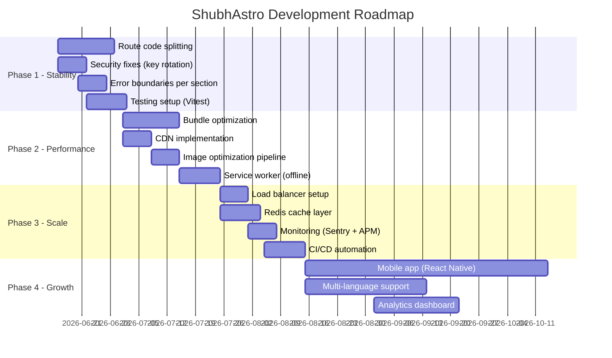

---

## 18. Risks & Recommendations

### Risk Matrix

| # | Risk | Impact | Probability | Mitigation |
|---|------|--------|-------------|------------|
| 1 | API keys exposed in git | Critical | Certain | Move to server-side proxy + secret manager |
| 2 | Single point of failure (Nginx) | High | Medium | Add load balancer + redundancy |
| 3 | No automated tests | High | High | Implement testing pyramid |
| 4 | No code splitting (huge bundle) | High | Certain | Add React.lazy() for routes |
| 5 | External API rate limits | Medium | Medium | Add Redis caching layer |
| 6 | Token theft via XSS | High | Low | Move to httpOnly cookies |
| 7 | No monitoring/alerting | High | High | Implement Sentry + CloudWatch |
| 8 | Dev/Stage same config | Medium | Certain | Separate credentials per env |
| 9 | No backup/DR plan | Critical | Low | Implement replica set + backups |
| 10 | Socket connection stability | Medium | Medium | Reconnection logic (implemented) |

---

## 19. Appendix

### Folder Structure

```
src/
├── agora/              # Agora RTC SDK integration
├── assets/             # Static images, icons, SVGs, SCSS variables
├── component/          # Reusable UI components (50+ components)
│   ├── UI/             # Cards, modals, tabs, charts, chips
│   ├── panditAI/       # AI chat bubble components
│   ├── call/           # Voice/Video call UI
│   └── formikcontrols/ # Form input components
├── context/            # React Context providers (Call, Chat, WaitingQueue, LiveList)
├── hooks/              # Custom React hooks
├── layouts/            # HomeLayout, Footer, NavigationSetup
├── redux/              # Redux slices + RTK Query API definitions
│   ├── api/            # 29+ feature API folders
│   ├── auth/           # Auth slice
│   ├── kundli/         # Kundli state
│   └── aiwow/         # AI WOW feature state
├── screens/            # Page components
│   ├── public/         # Login, Register, Coming Soon
│   ├── private/        # All feature screens
│   └── v2/            # Redesigned pages (Home, User)
├── services/           # API service layer
│   └── appServices/    # Business logic services
├── socket/             # Socket configuration
├── store/              # Redux store configuration
└── utils/              # Routes, helpers, constants, hooks
```

### Environment Variables

| Variable | Purpose |
|----------|---------|
| `VITE_APP_API_BASE_URL` | Backend API base URL |
| `VITE_RAZORPAY_KEY_ID` | Razorpay payment key |
| `VITE_AGORA_APP_ID` | Agora voice/video app ID |
| `VITE_GOOGLE_MAPS_API_KEY` | Google Maps |
| `VITE_VEDIC_API_USER_ID` | Vedic API user |
| `VITE_VEDIC_API_KEY` | Vedic API key |
| `VITE_HOROSCOPE_API_KEY` | Horoscope API key |
| `VITE_VEDIC_ASTRO_API_KEY` | Vedic Astro key |
| `VITE_TAROT_API_USER_ID` | Tarot API user |
| `VITE_TAROT_API_KEY` | Tarot API key |
| `VITE_SARVAM_API_KEY` | Sarvam TTS/STT |
| `VITE_FIREBASE_*` | Firebase configuration (6 vars) |
| `VITE_SHUBH_MALL_ENABLED` | Feature flag for e-commerce |

### Common Commands

```bash
# Development
npm run start              # Dev server (dev env)
npm run start-stage        # Dev server (stage env)
npm run start-prod         # Dev server (prod env)

# Build
npm run build-dev          # Build for development
npm run build-stage        # Build for staging
npm run build-prod         # Build for production

# Utilities
npm run preview            # Preview production build
npm run generate-sitemap   # Generate sitemap.xml
```

### Deployment Runbook

1. **Pre-deployment**
   - Ensure all tests pass (when implemented)
   - Review bundle size (`npm run build-prod`)
   - Verify environment variables in `.env-cmdrc`

2. **Build**
   ```bash
   npm run build-prod
   ```

3. **Deploy**
   ```bash
   # Copy dist/ to server
   rsync -avz dist/ user@server:/path/to/www/

   # Verify nginx config
   nginx -t

   # Reload nginx
   sudo systemctl reload nginx
   ```

4. **Post-deployment**
   - Verify site loads at `https://shubhastro.ai`
   - Check browser console for errors
   - Verify socket connections work
   - Test one consultation flow end-to-end
   - Monitor error rates for 30 minutes

5. **Rollback**
   ```bash
   # Keep previous dist backup
   mv /path/to/www/dist /path/to/www/dist.current
   mv /path/to/www/dist.backup /path/to/www/dist
   sudo systemctl reload nginx
   ```

---

*Document generated on June 10, 2026. Review and update quarterly.*
